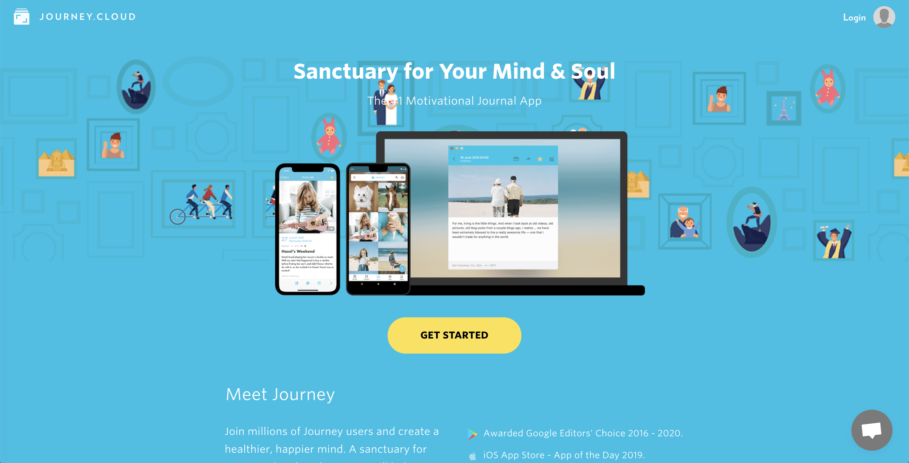
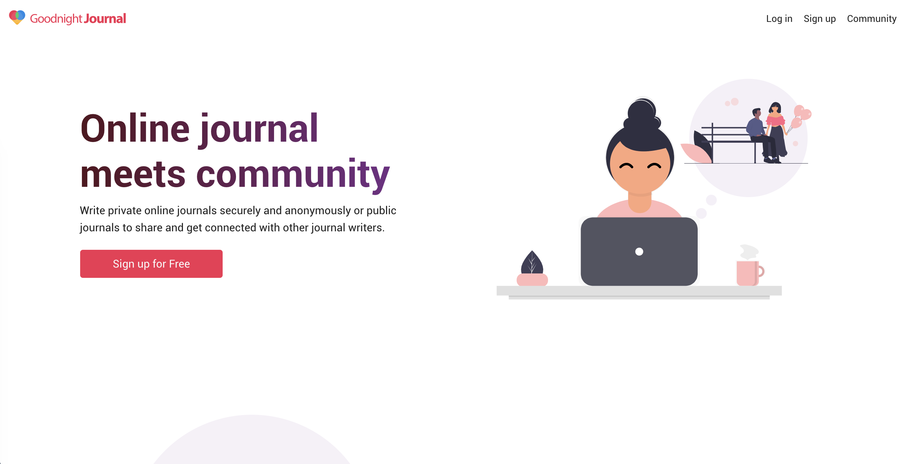
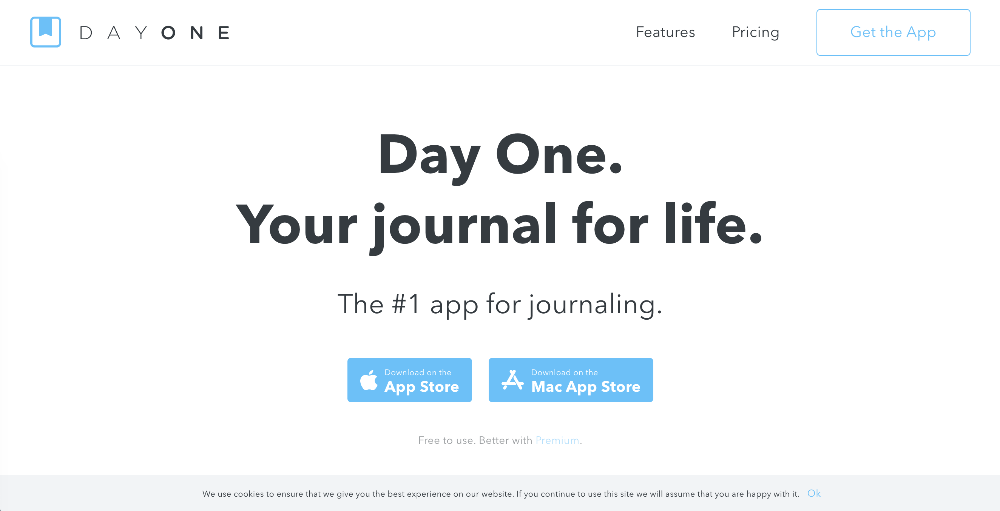

<strong>Disclosure:</strong> we run Goodnight Journal, one of the apps recommended below. We have tried to be fair and specific about what every app here does well, but you should weigh our recommendation knowing that.

If you have gone looking for a journaling app on Android, you have probably noticed the pattern. The app with the beautiful screenshots is iOS-only. The one that made the "best of" list has an Android version that was clearly built second. The reviews you find were written by someone on an iPhone.

Journaling software has been Apple-first for over a decade, and Android users have spent that time using ports. So this list is about which apps actually treat Android as a real platform, and what to look for if you want to avoid the ones that do not.

<h2>What matters on Android specifically</h2>

<b>A native app, not a wrapped website.</b> You can usually tell within a minute: scrolling feels slightly wrong, the back button does something unexpected, text selection fights you. A journal you use daily needs to feel right.

<b>A biometric or PIN lock.</b> This is the single most valuable security feature on a phone, and it matters more than any server-side promise. The realistic threat to your diary is someone who knows you picking up your unlocked phone — not a hacker. An app that can demand a fingerprint before it opens closes that gap.

<b>Backup you control.</b> Android's strength is that you are not locked into one company's cloud. An app that can export, or back up to Google Drive or Dropbox, is one you can leave.

<b>No iCloud dependency.</b> Some cross-platform journals sync through Apple's infrastructure, which quietly makes the Android version second-class. Check how sync works before you commit years of entries to it.

<b>Widgets and a share target.</b> Being able to write from the home screen, or send a photo straight into the journal, is the difference between journaling daily and journaling when you remember.

<h2>Journey</h2>

<b>The best pure Android journaling experience, and we will not pretend otherwise.</b> Journey was built with Android as a first-class target rather than a port, and it shows in the details — navigation that follows platform conventions, solid media handling, and automatic context like location attached to entries without being asked.

It also leans into coaching, with prompts and habit-style structure. If you want your journal to help you work on something specific, that scaffolding is genuinely useful.

If what you want is simply the most polished journaling app on Android, start here.

<a href="https://journey.cloud/" target="_blank" class="btn-cta">Journey</a>

<h2>Goodnight Journal</h2>

Our Android app covers the things above: autosave so nothing is lost mid-entry, daily reminders, journal prompts, dark mode, and a <b>PIN or fingerprint lock</b> so the app will not open just because the phone is unlocked.

Where it differs from everything else on this list is the community. Entries are private by default and sharing is a per-entry decision, not an account-wide setting — so you can keep years of writing to yourself and still publish the one entry you want other people to read. Writing something you assumed was uniquely strange and finding several people who have written almost the same thing is the thing that keeps a lot of people journaling on the days they would otherwise skip.

Because the platform is web-first, the Android app and the desktop site are genuinely the same journal rather than one being the compromise. An entry started on a laptop finishes on the phone.

<a href="https://www.goodnightjournal.com/" target="_blank" class="btn-cta">Goodnight Journal</a>

<h2>Daylio</h2>

Daylio is the Android pick for anyone who has tried journaling and given up. It does not ask you to write: you tap a mood, tap what you were doing, and the entry is finished in about ten seconds. Written notes are optional.

Keep it up for a few months and the charts become the point — you can see which activities reliably lift your mood and which flatten it. It is the easiest habit on this list to sustain, because it survives the days when you have nothing to say. It is a mood tracker rather than a diary, so if you want to write in sentences, look at the two above.

<a href="https://daylio.net/" target="_blank" class="btn-cta">Daylio</a>

<h2>Diaro</h2>

Diaro is for people who want their journal organised. Every entry can live in a folder and carry tags, so a few years of writing stays navigable instead of becoming one long scroll. It has a distraction-free writing mode and can sync to Dropbox, which fits the Android philosophy of not being locked to one provider.

<a href="https://diaroapp.com/" target="_blank" class="btn-cta">Diaro</a>

<h2>Day One, honestly</h2>

Day One is the most polished journaling app in existence and it does have an Android version. It is also unmistakably Apple-first, and that is worth knowing before you invest in it: the features arrive on iOS first and the experience is at its best there.

The reason to choose it anyway is end-to-end encryption, which none of the others here offer. If "nobody but me can technically read this" is a hard requirement, that outweighs everything else on this page — accepting the trade that losing your key means losing your journal.

<a href="https://dayoneapp.com/" target="_blank" class="btn-cta">Day One</a>

<h3>Which one</h3>

<b>Best Android app overall</b> — Journey.

<b>You want a community, and the same journal on your laptop</b> — <a href="https://www.goodnightjournal.com/"><b>Goodnight Journal</b></a>.

<b>You have failed at journaling before</b> — Daylio.

<b>You want structure and Dropbox backup</b> — Diaro.

<b>You need end-to-end encryption</b> — Day One.

One practical note: platform availability and app quality on Android both move around, so check the Play Store listing before you commit — including ours. And whichever you pick, turn on the app lock and find the export option in the first week.

For more, see <a href="/the-best-online-journal-2021/">how to choose the right online journal app</a>, <a href="/best-free-online-journal-apps/">the best free online journal apps</a>, and <a href="/how-to-keep-a-journal-private-online/">how to keep a journal private online</a>.

